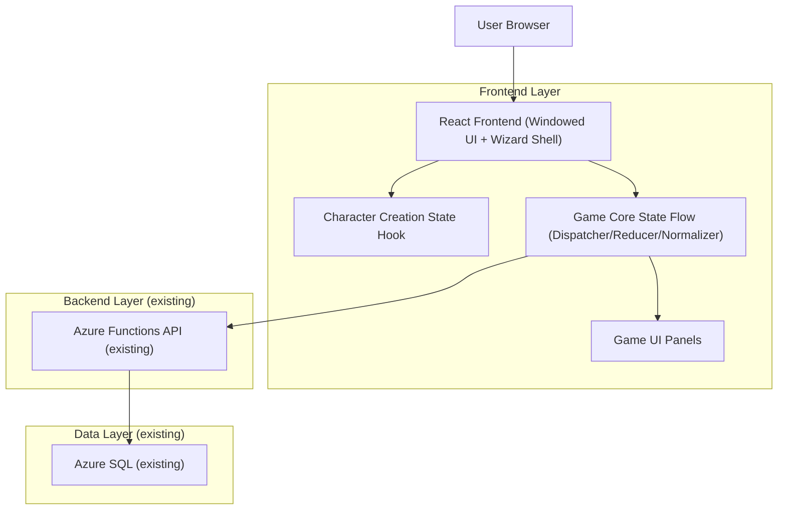
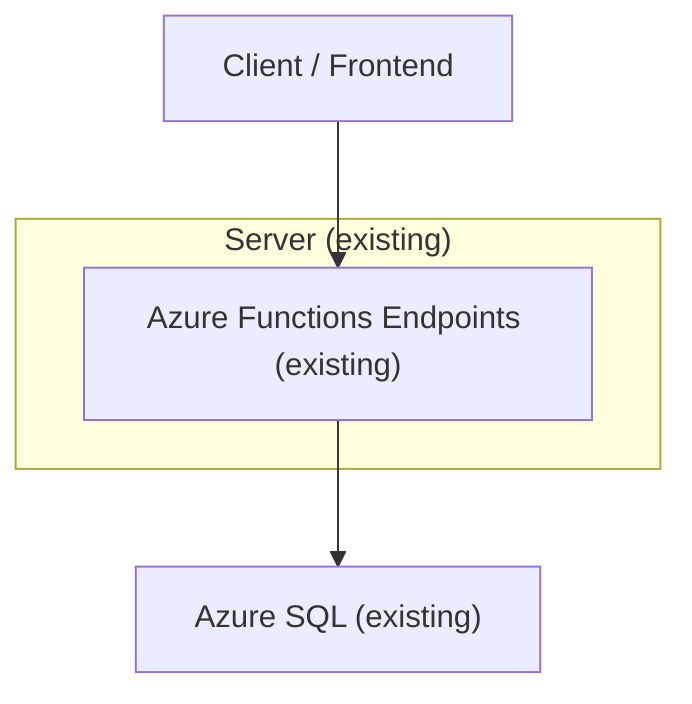

## 1.Architecture design


## 2.Technology Description
- Frontend: React@18 + existing WindowManager/DockZone UI (project code) + existing creation panels
- Backend: Azure Functions (existing; unchanged)
- Database: Azure SQL (existing; unchanged)

## 3.Route definitions
| Route | Purpose |
|-------|---------|
| / | Boot / entry; choose to start creation or resume (existing behavior) |
| /create | Character Creation Mode using guided wizard phases while reusing existing creation panels |
| /game | Main windowed gameplay UI (unchanged panels/layout) |

## 4.API definitions (If it includes backend services)
No new APIs are required for this redesign. Keep existing Azure Functions endpoints unchanged (e.g., saves/load, run tracking, snapshots, static data).

Shared TypeScript-style shape (conceptual) for the wizard output (must remain backward compatible):
```ts
type EntityRef = string | { id: string; name?: string };

type CharacterData = {
  name: string;
  gender: string;
  race: EntityRef;
  class: EntityRef;
  archetypeSystem: null | { id: string; name: string; category?: string; summary?: string; description?: string };
  profession: null | { id: string; name: string };
  professionSkills: Array<{ id: string; name: string; type: "profession"; description?: string; profession: string }>;
  activeSkills: Array<{ id: string; name?: string; type?: string }>;
  passiveSkills: Array<{ id: string; name?: string; type?: string }>;
  abilities: Array<{ id: string; name?: string; type?: string }>;
  attributes: Record<string, number> & { freePoints: 0 };
  hp: { current: number; max: number };
  mana: { current: number; max: number };
  resources: Record<string, number>;
  xp: { current: number; max: number };
  level: number;
  gold: number;
  currency: { goldCoins: number; soulpoints: number };
  professions: Record<string, { xp: number }>;
  inventory: any[];
  equipment: Record<string, any>;
};
```

## 5.Server architecture diagram (If it includes backend services)


## 6.Data model(if applicable)
### 6.1 Data model definition
The redesign does not introduce new persistent entities. It must continue emitting the existing character snapshot/schema used by save/load and the game reducer.

### 6.2 Data Definition Language
No schema changes required.

---
### Compatibility constraints (non-negotiable)
- Keep using the existing character creation state hook as the single source of truth for selections and final `characterData` generation.
- Reuse existing creation panels as-is where possible; add only a thin wizard orchestration layer that controls phase order, validation, and focused layout.
- Do not rename or remove fields in the finalized `characterData`; panels and systems must read the same structure