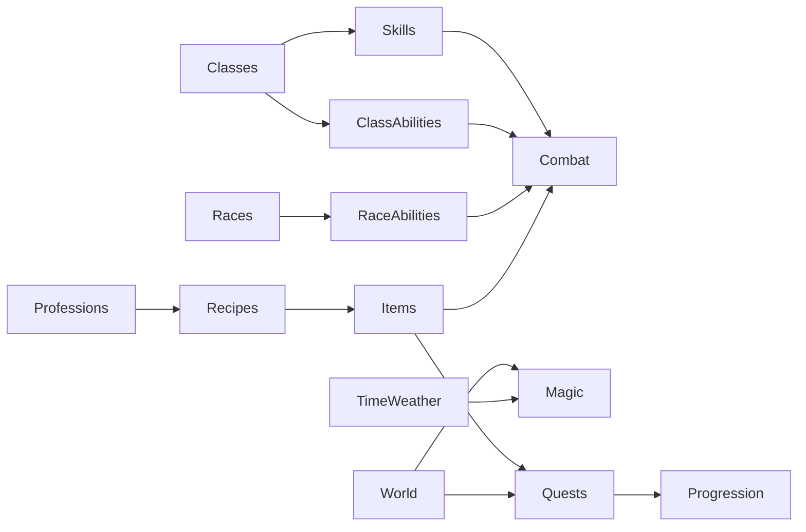

# Worldbuilding Systems Audit (War Room Output Backing Report)

## 1) Scope and Method

This audit reviews integration quality across:

- Character classes
- Races
- Skills and abilities
- Magic systems
- Professions and crafting
- Items and loot
- Quest metadata and world progression links

Evidence sources:

- Runtime registries in `packages/game-core/src`
- Godot slice manifests in `godot/data`
- Sync-side manifests in `functions/lib`
- Computed cross-reference metrics in `audit_worldbuild_metrics.json`

## 1.1) Progress Snapshot (2026-02-28)

After remediation passes, integrity gate status is:

- `npm run validate:worldbuild`: PASS
- `npm run validate:worldbuild:strict`: PASS

Current key signature values:

- `classesMissingSkills: 0` (was 12)
- `skillOwnersNotClassOrReserved: 0` (was 12)
- `missingRecipeIngredientCount: 0` (was 795)
- `missingRecipeResultCount: 0` (was 440)
- `missingQuestFavoredClassCount: 0` (was 28)
- `missingQuestRewardItemCount: 0` (was 27)
- `manifestMismatchCount: 0` (was 7)

Notes:

- Recipe/item closure currently uses generated placeholder item records for unresolved recipe IDs.
- Item registry size increased to support full reference closure; this is mechanically coherent but should be curated in a later content-quality pass.

## 2) System Topology (Intended)

## 3) Current State Metrics (Observed)

From `audit_worldbuild_metrics.json`:

- Classes: `30`
- Races: `55`
- Class abilities: `216`
- Race abilities: `55`
- Skills: `1648`
- Professions: `21`
- Items: `37`
- Quests: `29`

Structural distribution:

- Class tiers: `6` (T1), `12` (T2), `12` (T3)
- Resource systems: `mana=10`, `rage=5`, `energy=5`, `chi=5`, `focus=5`

High-risk mismatch counts:

- Classes with zero direct skill entries: `12` (all T3 classes)
- Skill-owner IDs not in class registry: `34` (legacy class IDs + profession IDs + `universal`)
- Recipe ingredient IDs missing from item registry: `795`
- Recipe result IDs missing from item registry: `440`
- Quest favored class IDs not in class registry: `28`
- Quest reward items missing from item registry: `27`

## 4) Dependency Findings

### A. Classes, Skills, and Abilities

Strengths:

- Class ability coverage exists for all class IDs (no class missing class abilities).
- Resource distribution is deliberate and symmetric around five resource archetypes.

Failure points:

- Tier-3 classes are present in class registry but absent as direct owners in skill registry.
- Skill registry still contains a parallel legacy class taxonomy (`knight`, `priest`, `templar`, etc.) that diverges from canonical class IDs.
- Profession skills share the same owner field (`class`) as combat classes, increasing ambiguity and error surface.

Design impact:

- Build planning and progression pacing become inconsistent.
- Quest affinity weighting and skill unlock UX can misfire because “class identity” is non-canonical.

### B. Races and Racial Effects

Strengths:

- Every race has race ability support.
- Race catalog depth is high and world flavor alignment is strong.

Failure points:

- Time/day-night combat modifiers are implemented only for a small subset of races, creating uneven systemic relevance across 55 race options.

Design impact:

- Many races feel cosmetic or front-loaded, with low sustained mechanical identity.

### C. Magic Integration

Strengths:

- Essence model is robust (12 primes + opposition pairs + resonance/taint/overload).
- Magic layer reads biome/weather/anomaly context from world registry.
- Spell study supports generation + evolution and tags for downstream filtering.

Failure points:

- Parallel spell/class identity stacks (`study`, legacy caster classes, canonical class IDs) complicate balancing.
- Magic progression is rich but difficult to tune against non-magic class budgets without a shared power budget framework.

Design impact:

- High risk of non-linear power spikes and onboarding confusion.

### D. Professions, Recipes, and Items

Strengths:

- Profession taxonomy is broad and well-themed (21 professions, 9-tier structure).
- Recipe generation framework scales content quickly.

Failure points:

- Recipe and item registries are largely disconnected by ID.
- Crafting outputs often do not resolve to actual item entities.
- Economy cannot stabilize when source catalogs and sink catalogs are non-overlapping.

Design impact:

- Crafting loop feels fake/proxy-driven rather than materially integrated.
- Loot-to-craft progression lacks trust and predictability.

### E. Quests and World Progression

Strengths:

- Quest tags include biome + tone + affinity concepts.
- Weighted selection logic exists.

Failure points:

- Many quest favored classes reference IDs not present in canonical class registry.
- Most quest reward item IDs are absent from item registry.
- `godot/data/world_manifest.json` and `functions/lib/sync-world-manifest.v1.json` are out of sync (different map graph and triggers).
- Quest flag vocabularies drift across Godot/sync pipelines.

Design impact:

- Narrative personalization and rewards are semantically rich but mechanically brittle.
- Cross-client progression parity is vulnerable to desync bugs.

## 5) Common Pitfalls in Successful RPG/LitRPG Systems

These are the failure modes top live games avoid aggressively:

- Taxonomy drift: multiple “truths” for classes/races/items.
- Content generation without compile-time reference validation.
- Broad combinatorics without bounded power budgets.
- Quest personalization data that references deprecated archetypes.
- Economy loops with weak item sinks and disconnected crafting outputs.
- Parallel world manifests per runtime (client/server/tooling) with no contract enforcement.

## 6) Best-Practice Integration Model

### 1. Canonical ID Spine

Maintain one canonical ID contract for:

- class
- race
- skill owner type + owner ID
- item
- recipe
- quest reward
- world map/location/flag identifiers

Generate all runtime artifacts from this contract.

### 2. Typed Ownership Model

Replace overloaded skill owner field:

- `ownerType`: `class | profession | universal | system`
- `ownerId`: canonical ID from the respective registry

### 3. Content Contract Tests as Build Gates

CI should fail on:

- Missing item refs in recipes/quests
- Missing class/race refs in quest affinity tags
- Nonexistent map/trigger/flag refs between Godot and sync manifests

### 4. Bounded Growth Design

Use hard/soft limits:

- Diminishing returns on damage multipliers, regen, and cooldown compression
- Caps on stackable multiplicative effects
- Tier budgets per class and per activity loop

### 5. Horizontal + Vertical Progression Balance

- Vertical: controlled numeric growth (TTK/TTS constraints)
- Horizontal: alternate utility/playstyle paths with similar budget value

## 7) Balancing Methodology (Recommended)

### A. Power Budget Equation

Define budget units per level band:

- `PowerBudget = DPS_weight + Survivability_weight + Utility_weight + Control_weight`

Constrain each class/race archetype to a target envelope per tier.

### B. Encounter Anchors

Track:

- Time-to-kill (TTK) targets by archetype and enemy tier
- Time-to-fail (TTF) targets for defensive archetypes
- Resource sustainability curves over 3/6/10 turn windows

### C. Economy Stability

For each tier:

- `NetInflation = currency_sources + item_sources - sinks`
- Keep inflation near a bounded corridor (e.g., ±5% per progression band)

### D. Monte Carlo + Worst-Case Sweeps

Run automated simulations for:

- Meta extremes (max crit, max CDR, max sustain)
- Quest reward throughput
- Craft loop profitability

### E. Regression Guardrails

Per patch:

- Delta budget per class <= defined threshold
- No new broken references
- No increased unresolved item references

## 8) Prioritized Recommendations

### P0 (Immediate, Blocker)

- Unify class taxonomy between class registry, skill registry, and quest tags.
- Add CI cross-reference validation for recipes/quests/items.
- Reconcile `godot/data/world_manifest.json` and `functions/lib/sync-world-manifest.v1.json`.
- Standardize quest flag dictionary across Godot + sync core.

### P1 (High)

- Introduce typed skill owner schema (`ownerType`/`ownerId`).
- Expand item registry to cover all referenced crafting and quest rewards.
- Add race-effect coverage policy so each race has sustained mechanical relevance.

### P2 (Medium)

- Build an automated balance harness (TTK/TTF/resource/economy simulations).
- Introduce explicit class tier power budgets and progression breakpoints.
- Tighten magic-combat interoperability constraints and expose debug telemetry.

### P3 (Longer-term)

- Build content authoring tools that emit validated registries.
- Add live-ops balancing dashboards for economy and build diversity.

## 9) Cohesion Design Targets

To keep worldbuilding mechanically sound and emotionally engaging:

- Every lore-significant system element must have at least one reliable gameplay affordance.
- Every gameplay-critical affordance must resolve to canonical IDs and validated data.
- Every progression axis (class/race/magic/profession) must have both identity and bounded power.
- Every reward promise (quest/craft/loot) must resolve to a real, usable item.

## 10) Acceptance Criteria for “Healthy Integration”

- `0` unresolved class references in quests and skills.
- `0` unresolved item references in recipes and quest rewards.
- `0` manifest drift between Godot and sync world specs.
- Tier-3 classes have complete skill identity paths or explicit design rationale.
- Automated balance tests pass for TTK, TTF, and economy inflation corridors.
