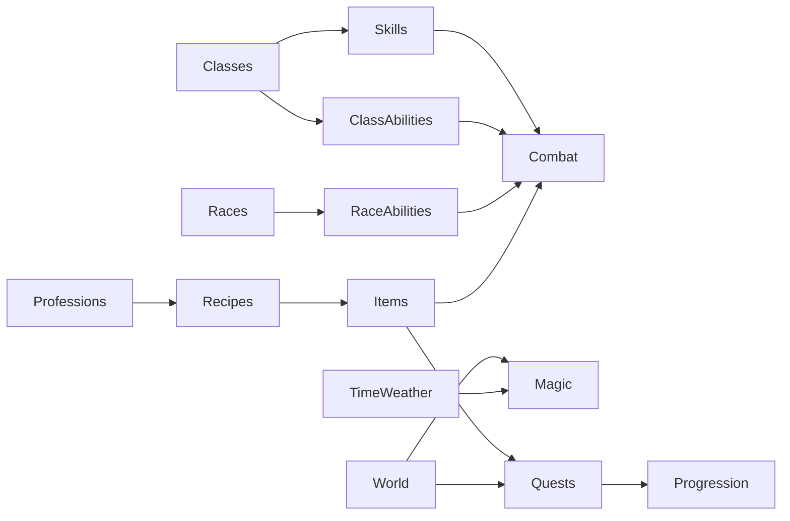

# Worldbuilding Systems Audit (War Room Output Backing Report)

Date: 2026-02-28

## 1) Scope and Method

This audit evaluates systemic integration across:

- Classes and class abilities
- Races and racial abilities
- Skills and magic layers
- Professions, recipes, and itemization
- Quest metadata and world progression links
- Godot runtime manifests and sync manifests

Evidence used:

- Runtime registries under `packages/game-core/src`
- World manifests in `godot/data/world_manifest.json` and `functions/lib/sync-world-manifest.v1.json`
- Computed cross-reference metrics in `audit_worldbuild_metrics.json`
- Integrity gate outputs from `npm run validate:worldbuild:strict`

## 2) Current Integrity Snapshot

Validation status (2026-02-28):

- `npm run validate:worldbuild`: PASS
- `npm run validate:worldbuild:strict`: PASS

Current key integrity signals:

- `classesMissingSkills: 0`
- `skillOwnersNotClassOrReserved: 0`
- `missingRecipeIngredientCount: 0`
- `missingRecipeResultCount: 0`
- `missingQuestFavoredClassCount: 0`
- `missingQuestRewardItemCount: 0`
- `manifestMismatchCount: 0`

## 3) System Topology (Intended)

## 4) Current State Metrics (Observed)

From `audit_worldbuild_metrics.json`:

- Classes: `30`
- Races: `55`
- Class abilities: `216`
- Race abilities: `55`
- Skills: `2246`
- Professions: `21`
- Items: `608`
- Quests: `29`

Structural distribution:

- Class tiers: `6` (T1), `12` (T2), `12` (T3)
- Resource systems: `mana=10`, `rage=5`, `energy=5`, `chi=5`, `focus=5`

Reference integrity counts:

- Classes with zero direct skill entries: `0`
- Skill owner IDs not class/reserved: `0`
- Missing recipe ingredient IDs: `0`
- Missing recipe result IDs: `0`
- Missing quest favored class IDs: `0`
- Missing quest reward item IDs: `0`
- Godot/sync manifest mismatch count: `0`

## 5) Dependency Findings

### A. Classes, Skills, and Abilities

Strengths:

- Canonical class IDs are now consistent across class registry, skill ownership, and quest affinity data.
- Tier-3 classes have direct skill ownership and no longer appear as orphan progression paths.
- Class ability coverage is complete for all class IDs.

Residual risks:

- Legacy consumers still read `skill.class`; dual-field compatibility (`class` + `ownerType/ownerId`) should be retained until all callers migrate.

### B. Races and Racial Effects

Strengths:

- Every race has race ability coverage.
- Race roster depth and thematic identity are strong.

Residual risks:

- Sustained mechanical differentiation across all races should be monitored, especially for long-session or endgame relevance.

### C. Magic Integration

Strengths:

- Magic model remains context-aware (world/time/weather interplay) and supports progression depth.
- Current reference closure prevents immediate integration breakage with class/race/quest systems.

Residual risks:

- Magic progression complexity can outpace non-magic budgets without explicit simulation guardrails.

### D. Professions, Recipes, and Items

Strengths:

- Profession/recipe graph is fully reference-closed against item IDs.
- Crafting and quest reward chains now resolve to concrete item entries.

Residual risks:

- Closure currently includes generated placeholder item records for unresolved recipe IDs, now tagged with provenance metadata for curation.
- Placeholder inflation can distort economy or reward quality if not curated into authored content.

### E. Quests and World Progression

Strengths:

- Favored class references are canonical and valid.
- Quest reward item references resolve to the registry.
- Godot and sync world manifests are now aligned for maps/triggers/objects.

Residual risks:

- Quest personalization quality remains dependent on ongoing class/race/profession balance curation, not only ID validity.

## 6) Common Failure Points to Keep Prevented

High-frequency failure modes in RPG/LitRPG system evolution:

- Taxonomy drift: multiple incompatible class/race/item vocabularies
- Content generation without hard reference checks
- Unlimited combinatorics without power ceilings
- Craft outputs that do not map to usable items
- Reward promises that do not resolve in runtime inventories
- Parallel world manifests without a contract gate

Current project status against these pitfalls:

- Most hard-reference pitfalls are remediated and currently guarded by strict integrity checks.
- Main remaining risk is quality/balance drift, not raw reference breakage.

## 7) Best-Practice Integration Model (Recommended)

### 1. Canonical ID Spine

Keep one canonical ID contract for:

- class
- race
- skill owner type/id
- item
- recipe
- quest reward
- map/trigger/object identifiers

### 2. Typed Skill Ownership

Move toward explicit ownership typing:

- `ownerType`: `class | profession | universal | system`
- `ownerId`: canonical ID for that owner type

### 3. Contract Gates in CI

Keep CI failing on:

- Missing recipe/quest item refs
- Missing quest class/race refs
- Manifest drift between Godot and sync runtime
- Runtime/env contract drift for backend and deployment-critical files

### 4. Bounded Growth Design

Maintain hard and soft limits for:

- Multiplicative damage and regen stacking
- Cooldown compression
- Sustain loops and resource bypass chains

### 5. Horizontal + Vertical Balance

- Vertical: bounded numeric progression per tier
- Horizontal: equivalent-value playstyle variance

## 8) Balancing Methodology

### A. Power Budget Envelope

Use tier-banded budget vectors:

- `PowerBudget = DPS + Survivability + Utility + Control`

### B. Encounter Anchors

Track and gate:

- Time-to-kill by archetype and enemy tier
- Time-to-fail for defensive builds
- Resource sustainability over 3/6/10 turn windows

### C. Economy Stability

Per progression band:

- `NetInflation = currency_sources + item_sources - sinks`
- Keep inflation in a bounded corridor (for example, +/-5%).

### D. Simulation Harness

Automate sweeps for:

- Extreme build combinations
- Craft profitability outliers
- Quest reward throughput pacing

### E. Regression Guardrails

Per content patch:

- No new unresolved references
- Class budget delta bounded by threshold
- Economy corridor remains in tolerance

## 9) Prioritized Recommendations

### P0 (Now)

- Keep `validate:worldbuild:strict` and runtime/env contract guards mandatory in CI.
- Prevent placeholder item leakage into player-facing loot tables without curation tags.

### P1 (High)

- Complete downstream migration from legacy `skill.class` reads to `ownerType` + `ownerId`.
- Add conversion workflow (placeholder -> authored item) using placeholder provenance metadata.

### P2 (Medium)

- Build an automated balance harness for TTK/TTF/resource/economy corridors.
- Add race and class long-session relevance checks (not only existence/coverage).

### P3 (Longer-term)

- Build authoring tools that emit validated registries by construction.
- Add live-ops dashboards for build diversity, economy pressure, and reward satisfaction.

## 10) Healthy Integration Acceptance Criteria

Current status versus target:

- `0` unresolved class references in quests/skills: Met
- `0` unresolved item references in recipes/quest rewards: Met
- `0` manifest drift between Godot and sync specs: Met
- Tier-3 class skill identity coverage: Met
- Automated balance corridor tests (TTK/TTF/economy): Not yet met

Overall assessment:

The worldbuilding system has moved from reference-fragile to mechanically coherent at the contract level. The next quality frontier is balance reliability and content curation depth, not structural integrity repair.
