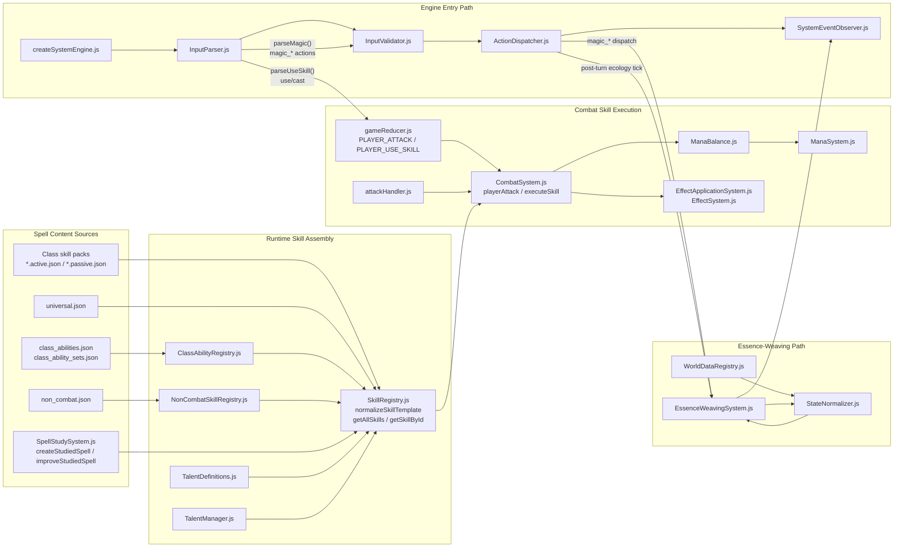

# Magic Systems Dependency Map

This document is the durable architecture map for the repo's two parallel magic paths:

- Combat spell skills
- Essence-weaving / ambient world magic

It is meant to complement, not replace, [research_findings_full-codebase.yaml](./research_findings_full-codebase.yaml).

## Dependency Diagram

## How To Read This

- Combat spell content is assembled from several sources, but `SkillRegistry.js` is the runtime choke point.
- Class abilities are not first-class skills in source data; they become skill-like records after `ClassAbilityRegistry.js` normalization.
- Studied spells are generated dynamically, not loaded from JSON packs.
- Essence weaving is a parallel magic system. It enters through `parseMagic()` and `ActionDispatcher.js`, not through `SkillRegistry.js`.
- Combat spell execution converges in `CombatSystem.js`, where talent-adjusted cost/cooldown logic, mana spending, damage, reactions, and effect application happen.
- Ambient essence state is stabilized by `StateNormalizer.js` and driven by `WorldDataRegistry.js` plus `processEssenceEcologyTurn()`.

## Long-Term Maintenance Notes

- If you add a new combat spell, start with the appropriate `*.active.json` / `*.passive.json` pack or the class ability data files, then verify `SkillRegistry.js` normalization and runtime lookup.
- If you add a new studied-spell behavior, update `SpellStudySystem.js` and then verify downstream compatibility with `SkillRegistry.js` and `CombatSystem.js`.
- If you change mana or cooldown behavior, inspect all four layers together: `TalentDefinitions.js`, `TalentManager.js`, `SkillRegistry.js`, and `CombatSystem.js`.
- If you change ambient magic behavior, inspect `InputParser.js`, `InputValidator.js`, `ActionDispatcher.js`, `EssenceWeavingSystem.js`, `StateNormalizer.js`, and `WorldDataRegistry.js` as one unit.
- A known nuance worth revisiting is that `CombatSystem.js` performs a top-level raw cooldown gate before the deeper bypass-aware execution path runs.

## Source Anchors

### Spell Content and Runtime Assembly

- `packages/game-core/src/systems/skills/SkillRegistry.js`
  - class pack imports: `45-87`
  - class database assembly: `97-119`
  - runtime normalization: `334-430`
  - class abilities converted into skill-like entries: `489-530`
  - runtime aggregation: `536-605`
  - O(1) lookup index and `getSkillById()`: `737-761`
  - modifier and usability helpers: `1108-1207`
- `packages/game-core/src/systems/class/ClassAbilityRegistry.js`
  - content loading: `6-7`
  - normalization and type inference: `52-100`
  - lineage-based class resolution: `134-163`
- `packages/game-core/src/systems/skills/SpellStudySystem.js`
  - prime essence definitions: `11-108`
  - spell forms: `110-144`
  - spell identification: `176-194`
  - studied spell creation and improvement: `196-315`
- `packages/game-core/src/systems/skills/NonCombatSkillRegistry.js`
  - non-combat spell-like content loading: `5-11`

### Combat Skill Resolution, Mana, and Cooldown

- `packages/game-core/src/core/InputParser.js`
  - `parseUseSkill()` and combat spell parsing: `250-321`
- `packages/game-core/src/core/actions/attackHandler.js`
  - parsed attack handoff into `playerAttack()` and `processEnemyTurns()`: `13-77`
- `packages/game-core/src/core/gameReducer.js`
  - `PLAYER_ATTACK` and `PLAYER_USE_SKILL` reducer entrypoints: `675-759`
- `packages/game-core/src/systems/combat/CombatSystem.js`
  - skill resolution from registry and player state: `227-245`
  - top-level player attack flow and cooldown gate: `587-969`
  - enemy turn continuation and cooldown decrement: `1633-1940`
  - execution core (`executeSkill()`): `2069-2225`
- `packages/game-core/src/systems/magic/ManaBalance.js`
  - cooldown tiers and cost multipliers: `57-95`
  - validation: `170-180`
- `packages/game-core/src/systems/magic/ManaSystem.js`
  - mana spending: `25-80`
  - regeneration: `123-145`
  - affordability helpers: `173-220`
- `packages/game-core/src/systems/skills/TalentManager.js`
  - bypass flags and overrides: `24-38`, `88-89`, `211-242`
- `packages/game-core/src/systems/skills/TalentDefinitions.js`
  - concrete mana and cooldown talent effects: `1477-1481`, `1658-1670`, `2305-2313`, `2606-2622`
  - modifier application switch: `2840-2905`

### Essence-Weaving Wiring

- `packages/game-core/src/engine/createSystemEngine.js`
  - engine parse -> validate -> execute -> observe path: `77-125`
- `packages/game-core/src/core/InputParser.js`
  - `parseMagic()` and `magic_*` action emission: `66-245`
- `packages/game-core/src/core/InputValidator.js`
  - top-level `magic_*` validation: `49-77`
  - combat gating and essence-specific validation helpers: `266-370`
- `packages/game-core/src/core/ActionDispatcher.js`
  - essence handler imports: `12-24`
  - `magic_*` routing: `82-252`
  - post-turn ecology tick: `453-470`
- `packages/game-core/src/systems/magic/EssenceWeavingSystem.js`
  - world dependency imports and prime essence setup: `2-60`
  - state hydration (`ensureEssenceWeavingState`, `ensurePlayerMagic`): `876-1196`
  - ecology update loop: `936-1125`
  - player-facing action handlers (`magicSense` through `magicRelease`): `1266-2465`
- `packages/game-core/src/core/StateNormalizer.js`
  - world essence normalization: `789-1108`
  - normalized result writeback: `1148-1188`
- `packages/game-core/src/world/WorldDataRegistry.js`
  - biome essence profiles and anomaly/source registries: `760-955`
- `packages/game-core/src/core/SystemEventObserver.js`
  - ambient-shift event observation: `30-137`, `395-401`
