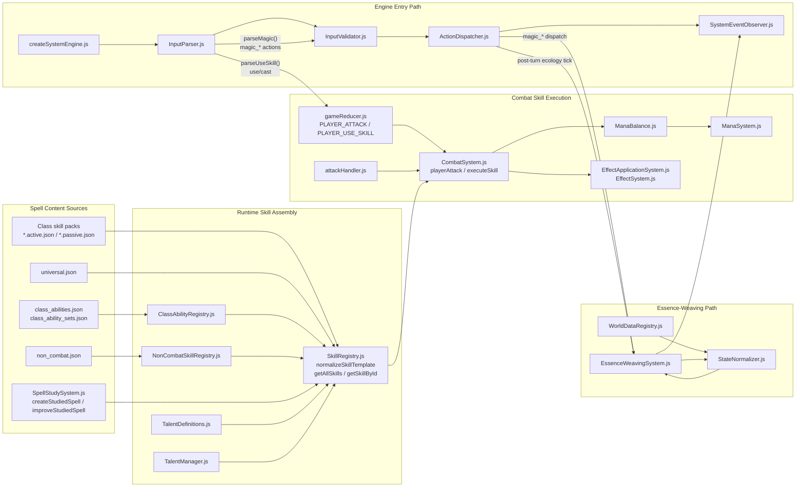

# Magic Systems Dependency Map

This document is the durable architecture map for the repo's two parallel magic paths:

- Combat spell skills
- Essence-weaving / ambient world magic

It is meant to complement, not replace, [research_findings_full-codebase.yaml](./research_findings_full-codebase.yaml).

## Dependency Diagram

## How To Read This

- Combat spell content is assembled from several sources, but `SkillRegistry.js` is the runtime choke point.
- Class abilities are not first-class skills in source data; they become skill-like records after `ClassAbilityRegistry.js` normalization.
- Studied spells are generated dynamically, not loaded from JSON packs.
- Essence weaving is a parallel magic system. It enters through `parseMagic()` and `ActionDispatcher.js`, not through `SkillRegistry.js`.
- Combat spell execution converges in `CombatSystem.js`, where talent-adjusted cost/cooldown logic, mana spending, damage, reactions, and effect application happen.
- Ambient essence state is stabilized by `StateNormalizer.js` and driven by `WorldDataRegistry.js` plus `processEssenceEcologyTurn()`.

## Long-Term Maintenance Notes

- If you add a new combat spell, start with the appropriate `*.active.json` / `*.passive.json` pack or the class ability data files, then verify `SkillRegistry.js` normalization and runtime lookup.
- If you add a new studied-spell behavior, update `SpellStudySystem.js` and then verify downstream compatibility with `SkillRegistry.js` and `CombatSystem.js`.
- If you change mana or cooldown behavior, inspect all four layers together: `TalentDefinitions.js`, `TalentManager.js`, `SkillRegistry.js`, and `CombatSystem.js`.
- If you change ambient magic behavior, inspect `InputParser.js`, `InputValidator.js`, `ActionDispatcher.js`, `EssenceWeavingSystem.js`, `StateNormalizer.js`, and `WorldDataRegistry.js` as one unit.
- A known nuance worth revisiting is that `CombatSystem.js` performs a top-level raw cooldown gate before the deeper bypass-aware execution path runs.

## Source Files

- `packages/game-core/src/systems/skills/SkillRegistry.js`
- `packages/game-core/src/systems/skills/SpellStudySystem.js`
- `packages/game-core/src/systems/class/ClassAbilityRegistry.js`
- `packages/game-core/src/systems/skills/NonCombatSkillRegistry.js`
- `packages/game-core/src/systems/skills/TalentDefinitions.js`
- `packages/game-core/src/systems/skills/TalentManager.js`
- `packages/game-core/src/systems/combat/CombatSystem.js`
- `packages/game-core/src/systems/magic/ManaBalance.js`
- `packages/game-core/src/systems/magic/ManaSystem.js`
- `packages/game-core/src/systems/magic/EssenceWeavingSystem.js`
- `packages/game-core/src/core/InputParser.js`
- `packages/game-core/src/core/InputValidator.js`
- `packages/game-core/src/core/ActionDispatcher.js`
- `packages/game-core/src/core/gameReducer.js`
- `packages/game-core/src/core/actions/attackHandler.js`
- `packages/game-core/src/core/StateNormalizer.js`
- `packages/game-core/src/core/SystemEventObserver.js`
- `packages/game-core/src/world/WorldDataRegistry.js`
